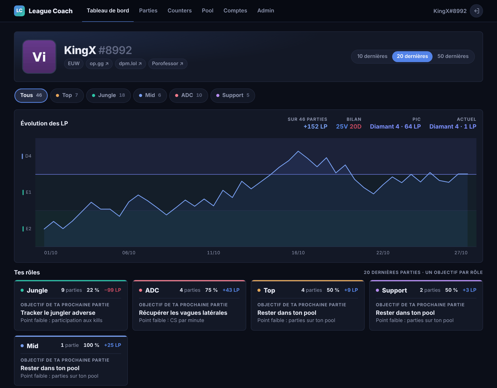
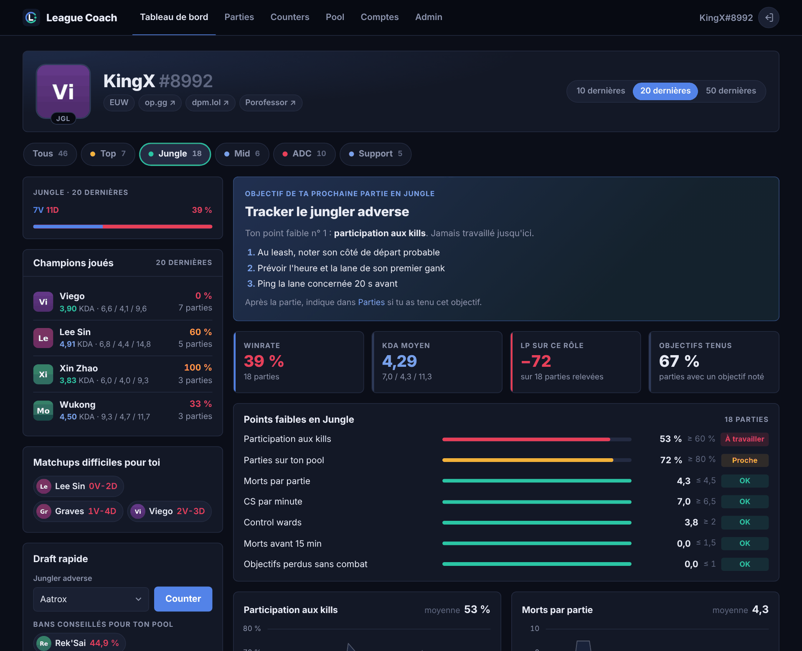
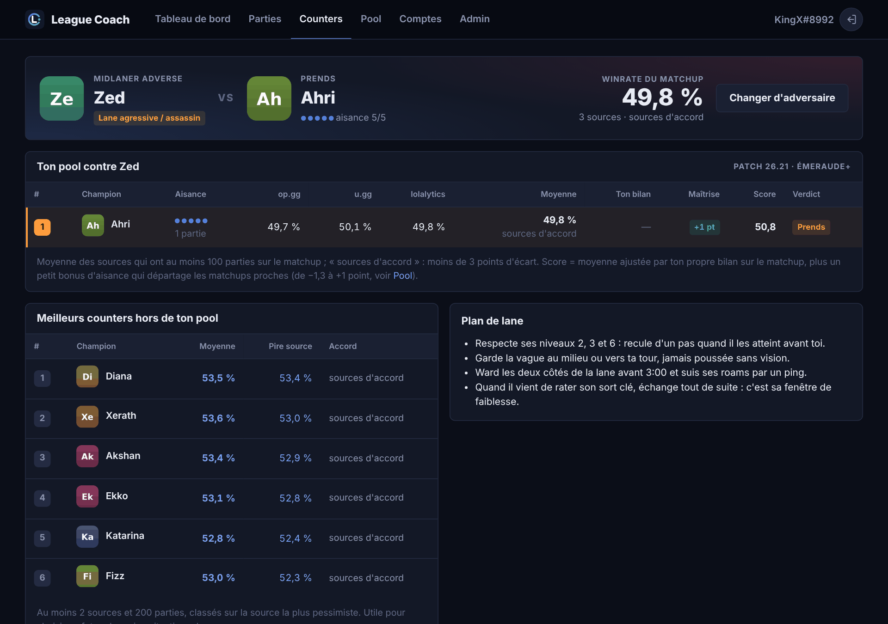
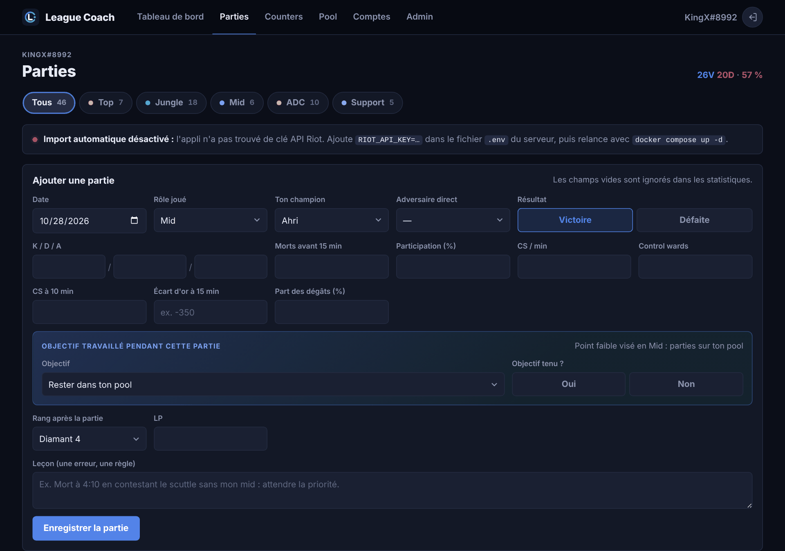

<div align="center">
  
  <h1>League Coach</h1>
  <p><b>Ton coach League of Legends auto-hébergé : un objectif concret par partie, dans chacun de tes rôles.</b></p>
  <p>
    <a href="LICENSE"></a>
    
    
    
  </p>
  <p>
    <a href="#démarrage-rapide">Démarrage rapide</a> ·
    <a href="#fonctionnalités">Fonctionnalités</a> ·
    <a href="#documentation">Documentation</a> ·
    <a href="#contribuer">Contribuer</a>
  </p>
  
</div>

<br>

League Coach importe tes parties classées depuis l'API officielle de Riot, repère ce qui te coûte des parties dans chaque rôle et te donne **un seul exercice à travailler** pour la suivante. En draft, il classe les champions de ton pool face à ton adversaire direct. Tout tourne sur ton serveur, dans un conteneur Docker, sans compte tiers.

## Fonctionnalités

- **Tous les rôles sur un même compte** : chaque partie est rangée dans le rôle réellement joué. Un autofill en top est compté, analysé et noté comme une partie de top.
- **Import automatique** : KDA, CS, vision, morts avant 15 min, écart d'or à 15 min, objectifs cédés sans combat, rang et LP gagnés à chaque partie.
- **Points faibles et objectif** : tes indicateurs sur les 10, 20 ou 50 dernières parties, comparés à des cibles de niveau Diamant, puis un exercice en trois étapes sur ton point faible principal.
- **Suivi** : après la partie, tu notes si tu as tenu l'objectif et une leçon. L'appli passe à l'exercice suivant quand celui-ci est maîtrisé.
- **Counters** : face à ton adversaire direct, ton pool classé selon trois sources de winrates (op.gg, u.gg, lolalytics), ton bilan personnel et ton aisance. Bans conseillés en prime.
- **Évolution des LP** : courbe par partie avec les divisions en fond, façon dpm.lol.
- **Multi-utilisateur** : plusieurs comptes LoL par utilisateur, plusieurs utilisateurs par instance. Interface en français, sans framework JavaScript.

## Démarrage rapide

Prérequis : Docker avec le plugin Compose. Une [clé API Riot](https://developer.riotgames.com) est facultative mais recommandée.

```bash
git clone https://github.com/WytherrX/league-coach.git && cd league-coach
cp .env.example .env
sed -i "s/^SECRET_KEY=$/SECRET_KEY=$(openssl rand -hex 32)/" .env
nano .env                                   # RIOT_API_KEY, BIND_IP, PORT, TZ…
docker compose up -d --build
docker compose logs | grep installation     # code pour créer le premier compte
```

Ouvre `http://<serveur>:8085/register` et crée ton compte avec ce code : le premier compte devient administrateur, puis les inscriptions se ferment. Ajoute ton Riot ID dans **Comptes** : tes 50 dernières parties classées arrivent en quelques minutes.

> [!NOTE]
> Par défaut, l'appli n'écoute que sur `127.0.0.1` et attend un reverse proxy en HTTPS. Pour un premier essai en HTTP depuis une autre machine, mets `BIND_IP=0.0.0.0` et `COOKIE_SECURE=false` dans `.env`. Voir [Installation et configuration](docs/installation.md).

### Mise à jour

```bash
cd league-coach && git pull && docker compose up -d --build
```

La base est migrée automatiquement au démarrage. `.env` et les données ne sont jamais touchés par une mise à jour.

## Aperçu

| Un onglet par rôle | Counters |
| :---: | :---: |
|  |  |
| **Parties à compléter** | **Tes rôles** |
|  | Chaque rôle a ses indicateurs, ses cibles, ses exercices, son champion pool et ses counters. Les captures utilisent des données de démonstration. |

## Documentation

| Guide | Contenu |
| --- | --- |
| [Installation et configuration](docs/installation.md) | Variables du `.env`, reverse proxy (Nginx Proxy Manager, Caddy, Traefik), mise à jour, sauvegarde |
| [Import Riot](docs/import-riot.md) | Clé API, ce qui est importé et comment chaque donnée est calculée, LP par partie |
| [Coaching et counters](docs/coaching.md) | Indicateurs et cibles par rôle, choix de l'objectif, calcul des counters, données de matchups et import d'un nouveau patch |
| [Sécurité](SECURITY.md) | Mots de passe, sessions, protections, signaler une faille |

## Contribuer

Les issues et les pull requests sont les bienvenues : nouveaux exercices, cibles mieux calibrées, données de matchups d'un nouveau patch, corrections. [CONTRIBUTING.md](CONTRIBUTING.md) explique comment lancer l'appli en local et où se trouve chaque chose.

Stack : Python 3.12, FastAPI, Jinja2 et SQLite, pages rendues côté serveur.

## Licence

[MIT](LICENSE) : tu peux utiliser, modifier et redistribuer le code librement, en conservant la mention de copyright.

<sub>League Coach n'est ni approuvé ni soutenu par Riot Games et ne reflète pas les opinions de Riot Games ni de quiconque officiellement impliqué dans la production ou la gestion des propriétés de Riot Games. Riot Games et toutes les propriétés associées sont des marques commerciales ou des marques déposées de Riot Games, Inc. Winrates de matchups : op.gg, u.gg et lolalytics.</sub>
